# Karoo Varia

Karoo extension with data fields to control the light of a Garmin Varia and show its battery status.

Not affiliated with or endorsed by Hammerhead or Garmin.

## Data fields

### Light mode

The field adapts to its size and only offers the modes your light reports. The highlight and the label change once the light reports the new mode, so they show what the light is really doing.

| Full display | Half display | One third |
|---|---|---|
| 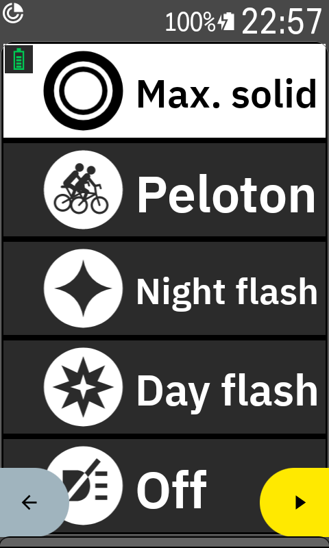 | 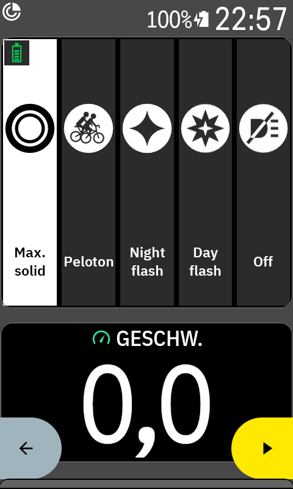 | 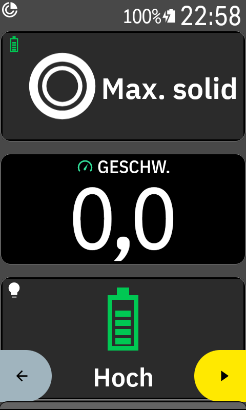 |
| Tap a mode to set it | Tap a mode to set it | Tap for the next mode |

| One row of a dense page | Half-width tile |
|---|---|
| 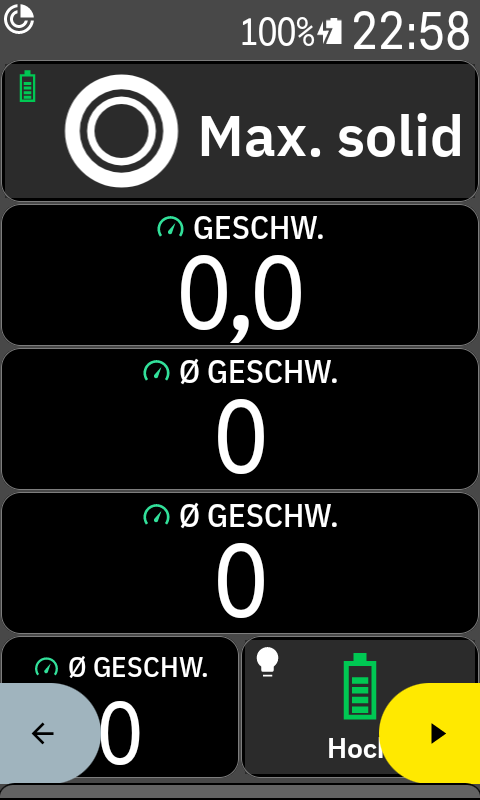 | 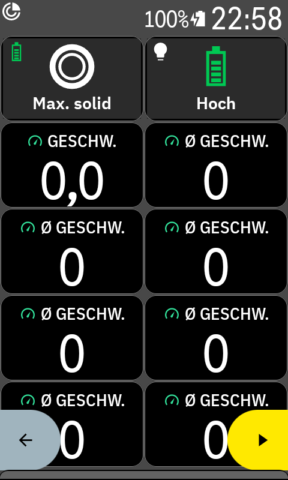 |
| Tap for the next mode | Tap for the next mode |

The small symbol in the top left corner shows the Varia's battery level. The screenshots show the Karoo's pre-ride screen, whose back and start buttons cover the bottom corners. They disappear once a ride starts.

### Varia battery

The Varia reports a status level, not a percentage.

| Level | Screenshot |
|---|---|
| Full | 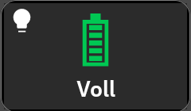 |
| High | 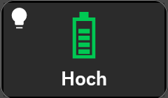 |
| Medium | 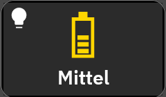 |
| Low | 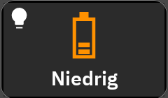 |
| Critical | 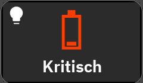 |
| Unknown | 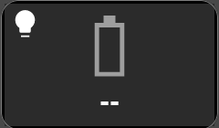 |

These levels were simulated for the screenshots, on a Karoo set to German. Labels follow the Karoo's language, English or German.

### Disconnected

When the radar is off or out of range, both fields turn gray and show Disconnected, and the light field stops reacting to taps. They recover on their own once the Karoo finds the radar again, which can take up to about a minute.

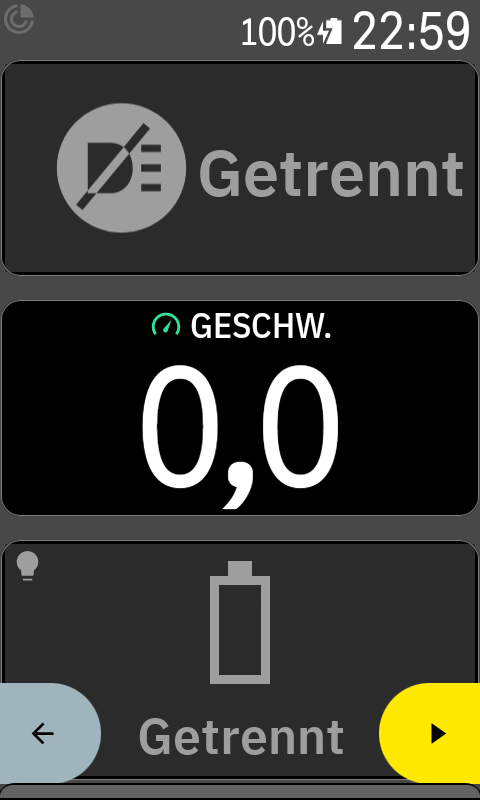

## Supported devices

**Lights**

| Light | Status | Notes |
|---|---|---|
| Varia RTL515 | Tested | Firmware 3.36, with Max. solid, Peloton, Night flash, Day flash and Off |
| Varia RearVue 820 | Not tested | Garmin documents the same modes as the RTL515 |
| Varia RTL516, eRTL616 | Not tested | Garmin documents only Solid and Standby, so the field should offer just those |
| Other Varia taillights, other ANT+ bike lights | Not tested | May work, but mode names can be wrong |

**Head units**

| Head unit | Status |
|---|---|
| Karoo 3 | Tested |
| Other Karoo models | Not tested |

Requirements and limits:

- The light must be paired over ANT+. If several lights are paired, the field controls the first one.
- Mode names are assigned by the ANT+ mode number: 4 Max. solid, 5 Peloton, 6 Night flash, 7 Day flash, 0 Off. They were confirmed on the RTL515 only, and any other mode shows its raw name with a generic icon.
- Garmin says an RTL515/RTL516 in Standby does not detect vehicles. On the tested RTL515 the radar kept sending data while the light reported Off, but detecting a vehicle in that state has not been tested, so check it before relying on it.

## Install

1. Download the APK from the [latest release](https://github.com/habbo656/Karoo-varia/releases/latest).
2. With the Karoo in developer mode and connected over USB, run `adb install karoo-varia-<version>.apk`.
3. Edit a data page in a ride profile and add the field from the puzzle-piece category: **Light mode** and **Varia battery** (**Lichtmodus** and **Varia-Akku** on a German Karoo).

## Good to know

- The Karoo extension SDK has no light control, so this extension uses a private Karoo interface. **A Karoo OS update could break the light field.**
- The Karoo's Auto Control still applies: it sets the default mode from the sensor's settings at ride start and turns the light off at ride end. The field shows Off for a few seconds at ride start, until the light turns on.
- If the Karoo's own light controls have no effect on your Varia, the field won't work either. On the tested setup, resetting the Varia and pairing it again fixed this.

## Build

Requires JDK 17 and the Android SDK (platform 34).

```
./gradlew :app:assembleDebug
```

Pushing a tag runs `.github/workflows/release.yml`, which publishes a GitHub release with a signed APK, using the version from the tag. It needs two repository secrets: `KEYSTORE_BASE64` (the base64-encoded signing keystore, with key alias `karoo-varia`) and `KEYSTORE_PASSWORD`.

`karoo-ext/` contains the sources of [karoo-ext](https://github.com/hammerheadnav/karoo-ext) 1.1.9 under the Apache 2.0 license.
