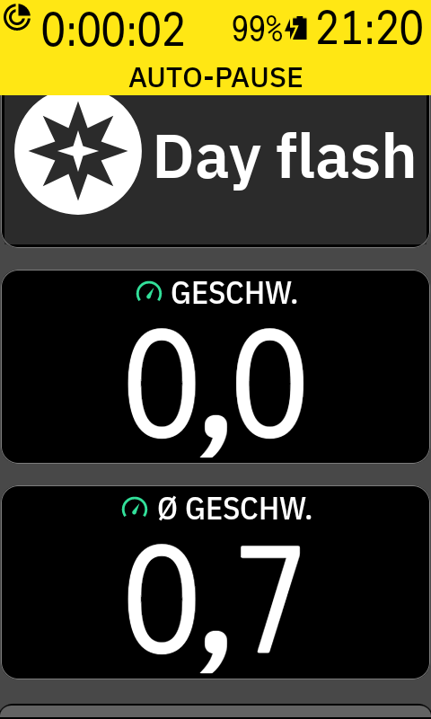
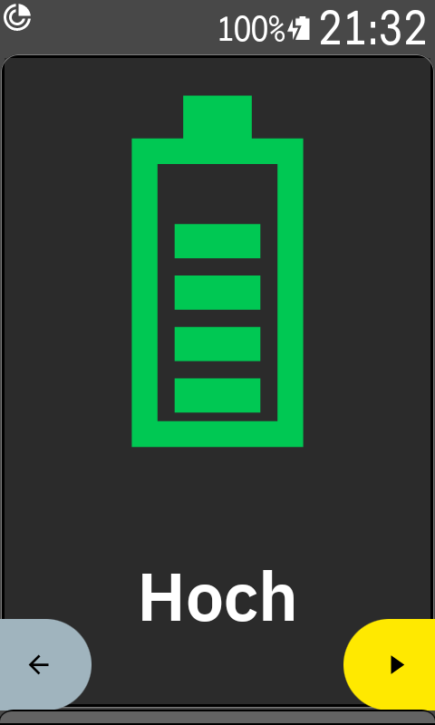

# Karoo Varia

Karoo extension with data fields to control the light of a Garmin Varia and show its battery status.

Not affiliated with or endorsed by Hammerhead or Garmin.

## Data fields

### Light mode

The field adapts to its size and only offers the modes your light reports.

| Full display | Half display | Small |
|---|---|---|
|  |  |  |
| Tap a mode to set it | Tap a mode to set it | Tap to switch to the next mode |

The highlight and the small field's label change once the light reports the new mode, so they show what the light is really doing. The yellow bar in the screenshots is the Karoo's Auto-Pause banner, and the half-display screenshot was taken in the page editor.

### Varia battery



Shows Full, High, Medium, Low or Critical. The Varia reports a status level, not a percentage. While the Varia is off or out of range, the field shows the last level the Karoo saved.

## Supported devices

| Device | Status |
|---|---|
| Karoo 3 with a Varia reporting model number 3592, firmware 3.36 | Tested |
| Varia RTL515, RearVue 820 | Untested. Garmin documents the same modes as the tested light |
| Varia RTL516, eRTL616 | Untested. Garmin documents only Solid and Standby, so the field should offer just those |
| Other Varia taillights and other ANT+ bike lights | Untested. May work, but mode names can be wrong |
| Other Karoo models | Untested |

Requirements and limits:

- The light must be paired over ANT+. If several lights are paired, the field controls the first one.
- Mode names are assigned by the ANT+ mode number: 4 Max. solid, 5 Peloton, 6 Night flash, 7 Day flash, 0 Off. They were confirmed on the tested light only, and any other mode shows its raw name with a generic icon.
- Garmin says an RTL515/RTL516 in Standby does not detect vehicles. Whether Off from this field does the same on those models is untested, so check that your radar still works before relying on it.

## Install

1. Download the APK from the [latest release](https://github.com/habbo656/Karoo-varia/releases/latest).
2. With the Karoo in developer mode and connected over USB, run `adb install karoo-varia-<version>.apk`.
3. Edit a data page in a ride profile and add the field from the puzzle-piece category: **Light mode** and **Varia battery** (**Lichtmodus** and **Varia-Akku** on a German Karoo).

## Good to know

- The Karoo extension SDK has no light control, so this extension uses a private Karoo interface. **A Karoo OS update could break the light field.**
- The Karoo's Auto Control still applies: it sets the default mode from the sensor's settings at ride start and turns the light off at ride end. The field shows Off for a few seconds at ride start, until the light turns on.
- If the Karoo's own light controls have no effect on your Varia, the field won't work either. On the tested setup, resetting the Varia and pairing it again fixed this.

## Build

Requires JDK 17 and the Android SDK (platform 34).

```
./gradlew :app:assembleDebug
```

Pushing a tag runs `.github/workflows/release.yml`, which publishes a GitHub release with a signed APK, using the version from the tag. It needs two repository secrets: `KEYSTORE_BASE64` (the base64-encoded signing keystore, with key alias `karoo-varia`) and `KEYSTORE_PASSWORD`.

`karoo-ext/` contains the sources of [karoo-ext](https://github.com/hammerheadnav/karoo-ext) 1.1.9 under the Apache 2.0 license.
